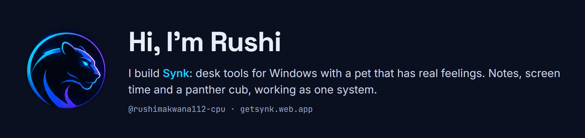

## What I'm building

| | |
|---|---|
| **Blink Notes** | One note on your desktop, saved by itself and synced live with your phone. |
| **Screen Time** | Today's real app usage on your PC. Nothing leaves your machine. |
| **Blue Panther** | A panther cub on your taskbar who sulks, hunts your cursor and keeps a diary. |
| **Lumina** | A tsundere angel cat, sold as a Microsoft Store add-on. |

## Shipped so far

- **18 Oct** · Synk 1.0.0 with automatic updates and a Microsoft Store build
- **29 Oct** · Synk 1.10.0: Desk Buddy Pet, Notes, Screen Time and Auto Clicker
- **1 Nov** · Lumina becomes a paid Store add-on
- **8 Nov** · All of Lumina's moves tested; her feelings show like a real pet's

**100** commits in three weeks · **2** platforms (Windows and Android) · **2** pet characters with feelings

## Tools I use

`Python` · `pywebview` · `PowerShell` · `MSIX · Microsoft Store` · `Android` · `Claude Code`

## Try Synk

Free on Windows 10 / 11. Lumina is an add-on.

**[⬇ Download Synk](https://github.com/rushimakwana112-cpu/Synk/releases/latest/download/Synk-Setup.zip)** · [getsynk.web.app](https://getsynk.web.app) · [Synk on GitHub](https://github.com/rushimakwana112-cpu/Synk)
